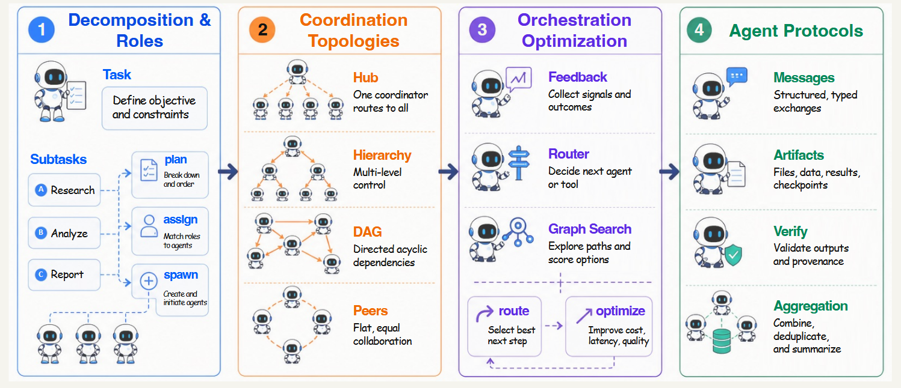

## Orchestration
多智能体协作可以从几个维度来描述：参与的智能体、交互类型（合作、竞争或混合）、通信结构、协调策略，以及该安排是静态的还是动态的。我们采用该分类法的一个务实版本，并提出四个问题：工作如何分解与分配，由此产生的计算呈现何种拓扑结构，该拓扑结构是固定的还是学习得到的，以及智能体之间如何通信。

### Decomposition and Roles
一个复杂任务应该拆成哪些子任务？由谁完成？
The first decision is how a long task is split into units and assigned to roles. The earliest harnesses fix this split statically, hard-coding the roles and their interaction pattern, whether as software-team standard operating procedures, planner–executor role-play, staged role-conditioned dialogues, or a general programmable substrate in which roles and their conversations are first-class
第一个决策是如何将长任务拆分为单元并分配给角色。最早的框架以静态方式固定这种拆分，硬编码角色及其交互模式，无论是作为软件团队标准操作流程、规划者–执行者角色扮演、分阶段角色条件对话，还是作为角色及其对话为一等公民的通用可编程基底
A predefined subtask graph is simple but brittle, since an early failure propagates downstream and a hand-coded role set scales poorly; this motivates dynamic decomposition that revises the split from feedback and can spawn a subtask-tailored subagent on the fly
预定义的子任务图虽然简单但脆弱，因为早期失败会向下游传播，且手工编码的角色集扩展性差；这促使了动态分解方法的出现，该方法能根据反馈修正任务拆分，并能即时生成针对子任务定制的子代理。
(1)Static Decomposition：静态任务分解
(2)Dynamic Decomposition：动态任务分解
由一个负责规划的 Agent 根据当前任务和执行反馈，动态调整任务分解方式，必要时创建新的子Agent。
### Coordination Topologies
多个 Agent 应该按照什么结构组织起来？
主要包括三种形式，集中式形式、去中心化形式、层级形式、DAG：有向无环图、竞争式协作。一但单元角色设定完毕，代理之间的连接方式便决定了计算的形态。这些拓扑结构包括围绕中心节点或者oechestrator构建的集中式形式，像peer debate和dynamic graphs，以及hierchical形式。
去中心化设计(Decentralized)允许在运行推理时进行select和prune(剪枝)，或者在大型网络结构上扩展协作。
上述连接机制引导智能体朝向共同目标协作，而另一互补体系则使交互本身具有竞争性，将两种角色置于类似GAN的循环中，一方不断提出更难的问题，另一方则努力求解，从而使这对角色在没有外部数据的情况下共同演化出一个自动课程。
### Orchestration Optimization
如何优化 Agent 之间的协作和任务调度？
拓扑可以手工设计或搜索得到。一条相关的研究路线学习每个单元由谁执行。在模型层面，路由器学习在性能、成本、延迟和拥塞约束下于多个模型之间进行选择。中央编排器可通过强化学习训练，以更低成本诱导紧凑协调，相关系统从零开始细化功能与协调。在大规模下，混合自组织协调甚至能超越手工设计的层级结构。如同技能库增长，这些对编排图的黑盒优化是一种外化的演化形式。
(1)Workflow Search：搜索更好的工作流结构
(2)Routing：动态选择 Agent 或模型
(3)Learning Coordination：学习协作策略：更进一步，不只是选择模型或 Agent，而是让系统自己学习如何协作。
一个中央 Orchestrator 可以通过强化学习进行训练，让它学会：
- 什么时候拆分任务？
- 应该创建几个子 Agent？
- 哪些任务需要并行执行？
- 哪些 Agent 应该协作？
- 如何减少不必要的通信和计算成本？
### Agent Protocols
Agent 之间如何交换信息、传递任务和整合结果？

最后，组合智能体必须可靠地交换消息。A2A协议以JSON-RPC为基础，通过流式传输突出Agent Cards、Tasks和Artifacts，IBM的Agent Communication Protocol提供了一种更轻量的REST原生替代方案，而MCP、ACP、A2A和ANP已在架构、发现、通信和安全性方面进行了比较。

## 总结
Orchestration 的完整逻辑
1. Decomposition and Roles
   
   将复杂任务拆分成多个子任务，并为每个子任务分配合适的 Agent。
   
   核心问题：做什么？谁来做？
2. Coordination Topologies
   
   确定 Agent 之间的连接关系和协作结构。
   
   核心问题：Agent 如何组织？
3. Orchestration Optimization
   
   根据任务需求和执行反馈，优化工作流、模型选择、路由和协作策略。
   
   核心问题：如何协作得更好？
4. Agent Protocols
   
   规范 Agent 之间的消息交换、任务传递和结果聚合。
   
   核心问题：Agent 如何可靠地交流？

